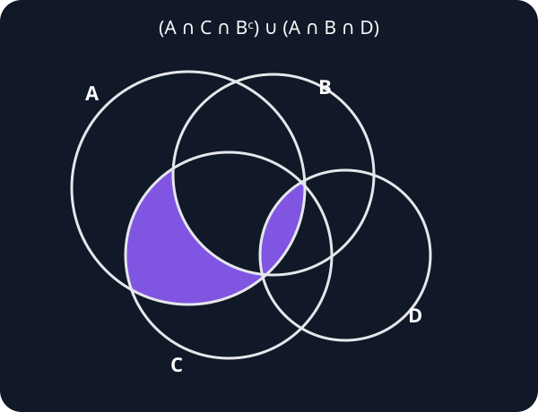

- **Problem 1**  
  Prove that every positive integer can be represented as a sum of distinct powers of two.

  - **Solution 1.1**  
    We prove the statement by strong induction on the positive integer $n$.

    **Base case.** For $n=1$,

    $$
    1=2^0,
    $$

    so the statement holds.

    **Induction hypothesis.** Fix an integer $n>1$ and suppose that every positive integer smaller than $n$ can be represented as a sum of distinct powers of two.

    **Induction step.** Choose the integer $k\geqslant0$ such that

    $$
    2^k\leqslant n<2^{k+1}.
    $$

    If $n=2^k$, then $n$ itself is a power of two, so the result follows immediately.

    Otherwise,

    $$
    0<n-2^k<2^k<n.
    $$

    By the induction hypothesis, there exist distinct nonnegative integers

    $$
    j_1,j_2,\ldots,j_m
    $$

    such that

    $$
    n-2^k=2^{j_1}+2^{j_2}+\cdots+2^{j_m}.
    $$

    Since $n-2^k<2^k$, every exponent $j_r$ is smaller than $k$. Hence $k,j_1,\ldots,j_m$ are distinct, and

    $$
    n=2^k+2^{j_1}+2^{j_2}+\cdots+2^{j_m}
    $$

    is a sum of distinct powers of two.

    Therefore, by strong induction, every positive integer can be represented as a sum of distinct powers of two.

---

- **Problem 2**  
  Draw the Euler–Venn diagram for

  $$
  \bigl((A\setminus B)\cap(C\cup(D\setminus A))\bigr)
  \cup(D\cap B\cap A).
  $$

  - **Solution 2.1**  
    Since $A\setminus B\subseteq A$, we have

    $$
    (A\setminus B)\cap(D\setminus A)=\varnothing.
    $$

    Therefore,

    $$
    \begin{aligned}
    &\bigl((A\setminus B)\cap(C\cup(D\setminus A))\bigr)
    \cup(D\cap B\cap A)\\
    &\qquad=(A\cap C\cap B^{\mathsf c})\cup(A\cap B\cap D).
    \end{aligned}
    $$

    Thus the shaded region consists of the part of $A\cap C$ outside $B$, together with $A\cap B\cap D$.

    

---

- **Problem 3**  
  Let $I$ be an index set, and let $\{A_i\}_{i\in I}$ be a family of sets. Prove De Morgan's laws without words; that is, show that every element of the set on the left belongs to the set on the right, and vice versa:

  $$
  \left(\bigcup_{i\in I}A_i\right)^{\mathsf c}
  =\bigcap_{i\in I}A_i^{\mathsf c}
  $$

  and

  $$
  \left(\bigcap_{i\in I}A_i\right)^{\mathsf c}
  =\bigcup_{i\in I}A_i^{\mathsf c},
  $$

  where $A^{\mathsf c}$ denotes the complement of $A$ in the universal set $U$.

  - **Solution 3.1**  
    $$
    \begin{aligned}
    x\in\left(\bigcup_{i\in I}A_i\right)^{\mathsf c}
    &\Longleftrightarrow x\notin\bigcup_{i\in I}A_i\\
    &\Longleftrightarrow\neg\bigl(\exists i\in I:x\in A_i\bigr)\\
    &\Longleftrightarrow\forall i\in I:x\notin A_i\\
    &\Longleftrightarrow\forall i\in I:x\in A_i^{\mathsf c}\\
    &\Longleftrightarrow x\in\bigcap_{i\in I}A_i^{\mathsf c},
    \qquad x\in U.
    \end{aligned}
    $$

    $$
    \begin{aligned}
    x\in\left(\bigcap_{i\in I}A_i\right)^{\mathsf c}
    &\Longleftrightarrow x\notin\bigcap_{i\in I}A_i\\
    &\Longleftrightarrow\neg\bigl(\forall i\in I:x\in A_i\bigr)\\
    &\Longleftrightarrow\exists i\in I:x\notin A_i\\
    &\Longleftrightarrow\exists i\in I:x\in A_i^{\mathsf c}\\
    &\Longleftrightarrow x\in\bigcup_{i\in I}A_i^{\mathsf c},
    \qquad x\in U.
    \end{aligned}
    $$

---

- **Problem 4: The Meticulous Job Applicant**  
  A company requires ideal candidates to satisfy all of the following conditions:

  - speak English;
  - have programming experience;
  - possess a university degree;
  - have at least two years of work experience.

  Describe in words the set of candidates who are not ideal for the position.

  - **Solution 4.1**  
    The candidates who are not ideal are precisely those who fail at least one of the requirements: they do not speak English, have no programming experience, do not possess a university degree, or have less than two years of work experience. This also includes candidates who fail two or more of these requirements.
