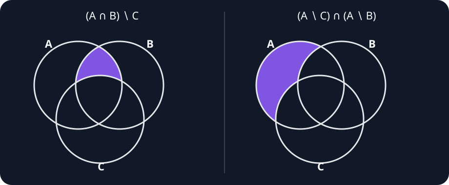
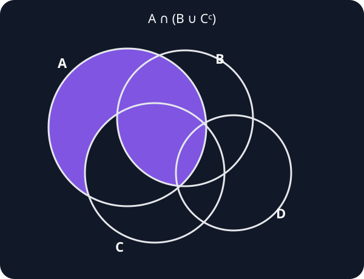

- **Exercise 1**
  Some of the following expressions are grammatically or logically incorrect. Identify them and explain the fault. In what follows,
  $$
  f\colon\mathbb R\to\mathbb R
  $$
  is a real function, and $A,B,C\subseteq\mathbb R$.

  1. $\{1+1\}$
  2. $\{3\}\setminus\{\{3\}\}$
  3. $1+1\Rightarrow2$
  4. $\{1,2\}\Leftrightarrow\{2,1\}$
  5. $\sqrt2\notin\mathbb Q$
  6. $\mathbb Z\setminus(\mathbb Z\setminus\mathbb N)$
  7. $\mathbb Z\Rightarrow\mathbb Q$
  8. $(|x|\in\mathbb Z)\Rightarrow(|x|\in\mathbb Q)$
  9. $(x\in A)\cup(x\in B)$
  10. $(3<1)\Rightarrow\varnothing$
  11. $A\leqslant(A\setminus B)$
  12. $f(A)\in\{f(A)\}$
  13. $(A\subset B)\cap C$
  14. $A\subset(B\cap C)$
  15. $A\subset B\subset A$
  16. $(2,4,6,\ldots)\subset(1,2,3,\ldots)$
  17. $\{A,\mathbb Z\}$
  18. $\{\varnothing\}\cap\varnothing$
  19. $f(1)\in\{2,3\}$
  20. $f(\{1,2\})\in\mathbb N$
  21. $f(\mathbb Q)\subset\mathbb Q$
  22. $\{x\in\mathbb N:-x\}$
  23. $\{-x:x\in\mathbb N\}$
  24. $\{x:x\Leftrightarrow2\}$
  25. $\{x\in\mathbb Z:x\notin\mathbb Z\}$
  26. $\{\{x:|x|<2\}\}$
  27. $\{x\in\mathbb Q:1=0\}$
  28. $\{x\in\mathbb Q:x^2\notin\mathbb Z\}$
  29. $\{\{f(x)\}:x\in\mathbb Q\}$
  30. $\{x:f(x)\in\mathbb Q\}$

  - **Solution 1.1**
    1. This is a well-formed set and equals $\{2\}$.
    2. This is a well-formed set. Since $3\ne\{3\}$, it equals $\{3\}$.
    3. This is grammatically incorrect. The symbol $\Rightarrow$ connects propositions, but $1+1$ and $2$ are numbers. The intended relation is $1+1=2$.
    4. This is grammatically incorrect. The symbol $\Leftrightarrow$ connects propositions, but both sides are sets. The correct statement is $\{1,2\}=\{2,1\}$.
    5. This is a well-formed and true proposition.
    6. This is a well-formed set expression. Since $\mathbb N\subseteq\mathbb Z$,
       $$
       \mathbb Z\setminus(\mathbb Z\setminus\mathbb N)=\mathbb N.
       $$
    7. This is grammatically incorrect. Implication cannot connect two sets. The intended statement is $\mathbb Z\subseteq\mathbb Q$.
    8. This is a well-formed formula and is true for every real $x$, because $\mathbb Z\subseteq\mathbb Q$.
    9. This is grammatically incorrect. The expressions $x\in A$ and $x\in B$ are propositions, so they must be joined by $\lor$, not by the set operation $\cup$.
    10. This is grammatically incorrect. The left-hand side is a proposition, while $\varnothing$ is a set and cannot be the right-hand side of an implication.
    11. This is grammatically incorrect because $\leqslant$ is not the inclusion relation between sets. If $\subseteq$ was intended, the resulting statement is not true in general.
    12. This is a well-formed and true proposition, since every object $Y$ satisfies $Y\in\{Y\}$.
    13. This is grammatically incorrect. The expression $A\subset B$ is a proposition, whereas $C$ is a set, so their intersection is not defined.
    14. This is a well-formed proposition whose truth depends on $A,B$, and $C$.
    15. If $\subset$ denotes proper inclusion, this is logically impossible: proper inclusion cannot hold in both directions. It should be written as two separate inclusion statements if ordinary inclusion is intended.
    16. This is grammatically incorrect because parentheses denote sequences or tuples, while $\subset$ compares sets. With braces, the intended inclusion is
        $$
        \{2,4,6,\ldots\}\subseteq\{1,2,3,\ldots\}.
        $$
    17. This is a well-formed set containing $A$ and $\mathbb Z$ as its elements.
    18. This is a well-formed set expression and equals $\varnothing$.
    19. This is a well-formed proposition whose truth depends on $f(1)$.
    20. If $f(\{1,2\})$ denotes the image of $\{1,2\}$, then it is a set of real numbers, not a natural number. The appropriate relation is $f(\{1,2\})\subseteq\mathbb R$.
    21. This is a well-formed proposition, but it is not true for every real function $f$. For example, the constant function $f(x)=\sqrt2$ does not satisfy it.
    22. This is grammatically incorrect. The expression following the colon must be a proposition, whereas $-x$ is a number.
    23. This is a well-formed set and consists of the negatives of the natural numbers.
    24. This is grammatically incorrect because $\Leftrightarrow$ connects propositions, while $x$ and $2$ are terms. The intended set is $\{x:x=2\}$.
    25. This is a well-formed set and equals $\varnothing$.
    26. Assuming $x\in\mathbb R$, this is a well-formed singleton whose only element is the set $\{x\in\mathbb R:|x|<2\}$.
    27. This is a well-formed set and equals $\varnothing$ because $1=0$ is false.
    28. This is a well-formed subset of $\mathbb Q$.
    29. This is a well-formed set whose elements are the singleton sets $\{f(x)\}$ for $x\in\mathbb Q$.
    30. This is a well-formed set once the domain of $x$ is made explicit. More precisely,
        $$
        \{x\in\mathbb R:f(x)\in\mathbb Q\}=f^{-1}(\mathbb Q).
        $$

---

- **Exercise 2**
  The following expressions define sets. Turn the words into symbols.

  1. The set of negative odd integers.
  2. The set of natural numbers with three decimal digits.
  3. The set of rational numbers that are ratios of odd integers.
  4. The set of rational numbers between $3$ and $\pi$.
  5. The set of real numbers at distance $\frac14$ from an integer.
  6. The complement of the unit circle in the Cartesian plane.
  7. The set of lines tangent to the unit circle.

  - **Solution 2.1**
    1. $\{n\in\mathbb Z:n<0\text{ and }n=2k+1\text{ for some }k\in\mathbb Z\}$.
    2. $\{n\in\mathbb N:100\leqslant n\leqslant999\}$.
    3. $\left\{\frac pq:p,q\in\mathbb Z,\ p\text{ and }q\text{ are odd},\ q\ne0\right\}$.
    4. $\{q\in\mathbb Q:3<q<\pi\}$.
    5. $\left\{x\in\mathbb R:|x-n|=\frac14\text{ for some }n\in\mathbb Z\right\}$.
    6. $\{(x,y)\in\mathbb R^2:x^2+y^2\ne1\}$.
    7. $\left\{L_{a,b}:a,b\in\mathbb R,\ a^2+b^2=1\right\}$, where
       $$
       L_{a,b}=\{(x,y)\in\mathbb R^2:ax+by=1\}.
       $$

---

- **Exercise 3**
  Draw the Euler–Venn diagrams for
  $$
  (A\cap B)\setminus C
  \qquad\text{and}\qquad
  (A\setminus C)\cap(A\setminus B).
  $$

  - **Solution 3.1**
    The two regions can be written as
    $$
    (A\cap B)\setminus C
    =A\cap B\cap C^{\mathsf c}
    $$
    and
    $$
    \begin{aligned}
    (A\setminus C)\cap(A\setminus B)
    &=A\cap C^{\mathsf c}\cap B^{\mathsf c}\\
    &=A\setminus(B\cup C).
    \end{aligned}
    $$

    

---

- **Exercise 4**
  Draw the Euler–Venn diagram for
  $$
  \bigl((A\cap B)\cap(C\cup D)\bigr)\cup(A\setminus C).
  $$

  - **Solution 4.1**
    If a point lies in $A\setminus C$, then it belongs to the required region. If it lies in $A\cap C$, then the first term requires it to belong to $B$, while membership in $D$ is irrelevant. Therefore,
    $$
    \begin{aligned}
    \bigl((A\cap B)\cap(C\cup D)\bigr)\cup(A\setminus C)
    &=(A\cap B\cap C)\cup(A\cap C^{\mathsf c})\\
    &=A\cap(B\cup C^{\mathsf c}).
    \end{aligned}
    $$
    Thus the diagram shades all of $A$ outside $C$, together with $A\cap B\cap C$. The set $D$ does not change the shaded region.

    
