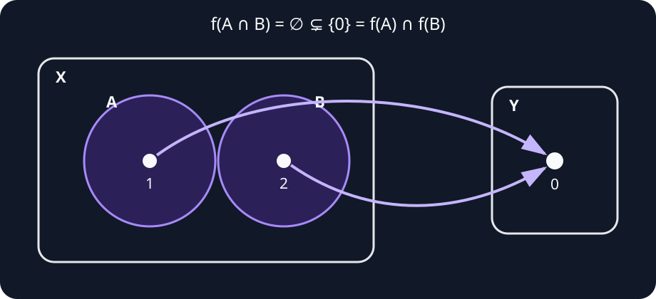
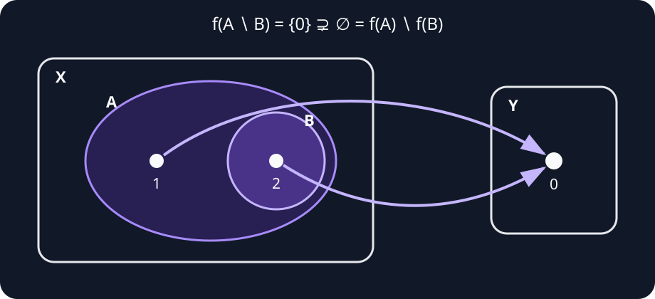

- **Exercise 1**
  Let
  $$
  A=\{1,2,3,4\}
  \qquad\text{and}\qquad
  B=\{1,2,3,4,5\}.
  $$
  The maps $f\colon A\to B$ and $g\colon B\to A$ are given by
  $$
  \begin{array}{c|cccc}
  x&1&2&3&4\\ \hline
  f(x)&3&4&2&5
  \end{array}
  \qquad
  \begin{array}{c|ccccc}
  y&1&2&3&4&5\\ \hline
  g(y)&2&1&2&3&4.
  \end{array}
  $$
  Find the compositions $f\circ g\colon B\to B$ and $g\circ f\colon A\to A$. Are they injections, surjections, or bijections? Find $f^{-1}$, $g^{-1}$, $g^{-1}\circ f^{-1}$, and $(f\circ g)^{-1}$.

  Here $f^{-1}$ and $g^{-1}$ denote preimage operations on subsets. For example,
  $$
  f^{-1}(S)=\{a\in A:f(a)\in S\}
  $$
  for $S\subseteq B$.

  - **Solution 1.1**
    The two compositions are
    $$
    \begin{array}{c|ccccc}
    y&1&2&3&4&5\\ \hline
    (f\circ g)(y)&4&3&4&2&5
    \end{array}
    $$
    and
    $$
    \begin{array}{c|cccc}
    x&1&2&3&4\\ \hline
    (g\circ f)(x)&2&3&1&4.
    \end{array}
    $$

    Since $(f\circ g)(1)=(f\circ g)(3)=4$, the map $f\circ g$ is not injective. Its image is $\{2,3,4,5\}$, so it is not surjective and therefore not bijective.

    The map $g\circ f$ takes the four distinct values $2,3,1,4$. Hence it is injective and surjective, so it is bijective.

    The preimage maps are
    $$
    f^{-1}\colon\mathcal P(B)\to\mathcal P(A)
    \qquad\text{and}\qquad
    g^{-1}\colon\mathcal P(A)\to\mathcal P(B).
    $$
    Their values on singleton sets are
    $$
    \begin{array}{c|ccccc}
    S&\{1\}&\{2\}&\{3\}&\{4\}&\{5\}\\ \hline
    f^{-1}(S)&\varnothing&\{3\}&\{1\}&\{2\}&\{4\}
    \end{array}
    $$
    and
    $$
    \begin{array}{c|cccc}
    T&\{1\}&\{2\}&\{3\}&\{4\}\\ \hline
    g^{-1}(T)&\{2\}&\{1,3\}&\{4\}&\{5\}.
    \end{array}
    $$
    For arbitrary subsets, these tables determine the preimages through
    $$
    f^{-1}(S)=\bigcup_{b\in S}f^{-1}(\{b\})
    \qquad\text{and}\qquad
    g^{-1}(T)=\bigcup_{a\in T}g^{-1}(\{a\}).
    $$

    For every $S\subseteq B$,
    $$
    \begin{aligned}
    (g^{-1}\circ f^{-1})(S)
    &=g^{-1}(f^{-1}(S))\\
    &=\{y\in B:f(g(y))\in S\}\\
    &=(f\circ g)^{-1}(S).
    \end{aligned}
    $$
    Thus $g^{-1}\circ f^{-1}$ and $(f\circ g)^{-1}$ are the same map from $\mathcal P(B)$ to $\mathcal P(B)$. Their values on singleton sets are
    $$
    \begin{array}{c|ccccc}
    S&\{1\}&\{2\}&\{3\}&\{4\}&\{5\}\\ \hline
    (g^{-1}\circ f^{-1})(S)
    &\varnothing&\{4\}&\{2\}&\{1,3\}&\{5\}.
    \end{array}
    $$

---

- **Exercise 2**
  Let $f\colon X\to Y$. Prove that for any two subsets $A,B\subseteq Y$, the following equalities hold. Use only symbols, with no words or pictures.

  1. $f^{-1}(A\cup B)=f^{-1}(A)\cup f^{-1}(B)$.
  2. $f^{-1}(A\cap B)=f^{-1}(A)\cap f^{-1}(B)$.
  3. $f^{-1}(A\setminus B)=f^{-1}(A)\setminus f^{-1}(B)$.

  - **Solution 2.1**
    1.
       $$
       \begin{aligned}
       x\in f^{-1}(A\cup B)
       &\Longleftrightarrow f(x)\in A\cup B\\
       &\Longleftrightarrow f(x)\in A\lor f(x)\in B\\
       &\Longleftrightarrow x\in f^{-1}(A)\lor x\in f^{-1}(B)\\
       &\Longleftrightarrow x\in f^{-1}(A)\cup f^{-1}(B).
       \end{aligned}
       \qquad(x\in X)
       $$

    2.
       $$
       \begin{aligned}
       x\in f^{-1}(A\cap B)
       &\Longleftrightarrow f(x)\in A\cap B\\
       &\Longleftrightarrow f(x)\in A\land f(x)\in B\\
       &\Longleftrightarrow x\in f^{-1}(A)\land x\in f^{-1}(B)\\
       &\Longleftrightarrow x\in f^{-1}(A)\cap f^{-1}(B).
       \end{aligned}
       \qquad(x\in X)
       $$

    3.
       $$
       \begin{aligned}
       x\in f^{-1}(A\setminus B)
       &\Longleftrightarrow f(x)\in A\land f(x)\notin B\\
       &\Longleftrightarrow x\in f^{-1}(A)\land x\notin f^{-1}(B)\\
       &\Longleftrightarrow x\in f^{-1}(A)\setminus f^{-1}(B).
       \end{aligned}
       \qquad(x\in X)
       $$

---

- **Exercise 3**
  Let $f\colon X\to Y$. Prove that for any two subsets $A,B\subseteq X$, the following relations hold. Use only symbols, with no words or pictures.

  1. $f(A\cup B)=f(A)\cup f(B)$.
  2. $f(A\cap B)\subseteq f(A)\cap f(B)$.
  3. $f(A\setminus B)\supseteq f(A)\setminus f(B)$.

  Give examples showing that the inclusions in parts 2 and 3 can be strict, and draw corresponding diagrams similar to Euler–Venn diagrams.

  - **Solution 3.1**
    1.
       $$
       \begin{aligned}
       y\in f(A\cup B)
       &\Longleftrightarrow \exists x\in A\cup B\;(f(x)=y)\\
       &\Longleftrightarrow
       \bigl(\exists x\in A\;(f(x)=y)\bigr)
       \lor
       \bigl(\exists x\in B\;(f(x)=y)\bigr)\\
       &\Longleftrightarrow y\in f(A)\cup f(B).
       \end{aligned}
       \qquad(y\in Y)
       $$

    2.
       $$
       \begin{aligned}
       y\in f(A\cap B)
       &\Longrightarrow \exists x\in X\;
       (x\in A\land x\in B\land f(x)=y)\\
       &\Longrightarrow
       \bigl(\exists x\in A\;(f(x)=y)\bigr)
       \land
       \bigl(\exists x\in B\;(f(x)=y)\bigr)\\
       &\Longrightarrow y\in f(A)\cap f(B).
       \end{aligned}
       \qquad(y\in Y)
       $$

    3.
       $$
       \begin{aligned}
       y\in f(A)\setminus f(B)
       &\Longrightarrow
       \bigl(\exists x\in A\;(f(x)=y)\bigr)
       \land
       \bigl(\nexists b\in B\;(f(b)=y)\bigr)\\
       &\Longrightarrow \exists x\in A\setminus B\;(f(x)=y)\\
       &\Longrightarrow y\in f(A\setminus B).
       \end{aligned}
       \qquad(y\in Y)
       $$

    For part 2, let
    $$
    X=\{1,2\},\qquad Y=\{0\},\qquad f(1)=f(2)=0,
    $$
    and take $A=\{1\}$ and $B=\{2\}$. Then
    $$
    f(A\cap B)=\varnothing
    \subsetneq
    \{0\}=f(A)\cap f(B).
    $$

    

    For part 3, use the same map and take $A=\{1,2\}$ and $B=\{2\}$. Then
    $$
    f(A\setminus B)=\{0\}
    \supsetneq
    \varnothing=f(A)\setminus f(B).
    $$

    

