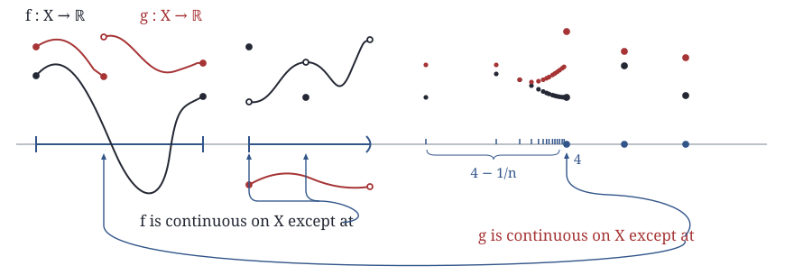

- **Definition 1**
  Let $f\colon X\to\mathbb R$ be a function, and let $x_0\in X$. We say that $f$ is continuous at $x_0$ if, for every $\varepsilon>0$, there exists $\delta>0$ such that, for every $x\in X$,
  $$
  |x-x_0|<\delta\implies |f(x)-f(x_0)|<\varepsilon.
  $$

- **Question 1.1**
  Is this definition equivalent to the condition
  $$
  \lim_{x\to x_0}f(x)=f(x_0)?
  $$

  In general, no. Definition 1 requires $x_0$ to belong to the domain and allows $x_0$ to be an isolated point. If $x_0$ is a limit point of $X$, the answer is yes. In that case, the limit condition means that for every $\varepsilon>0$, there exists $\delta>0$ such that, for every $x\in X$,
  $$
  0<|x-x_0|<\delta\implies |f(x)-f(x_0)|<\varepsilon.
  $$
  If $x_0\in X$ is not a limit point of $X$, then $x_0$ is an isolated point of $X$.

---

- **Definition 2**
  Let $f\colon X\to\mathbb R$ be a function, and let $x_0\in X$.

  1. If $x_0$ is an isolated point of $X$, then $f$ is always continuous at $x_0$.
  2. If $x_0$ is a limit point of $X$, then $f$ is continuous at $x_0$ if and only if
     $$
     \lim_{x\to x_0}f(x)=f(x_0).
     $$

- **Example 2.1**
  Let $f,g\colon X\to\mathbb R$. The graphs show where each function is continuous on $X$.

  

---

- **Theorem 3**
  Let $f\colon X\to\mathbb R$, and suppose $x_0\in X$ is a limit point of $X$. Then $f$ is continuous at $x_0$ if and only if, for every sequence $(a_n)$ in $X$ with $a_n\to x_0$,
  $$
  \lim_{n\to\infty}f(a_n)
  =f(x_0)
  =f\left(\lim_{n\to\infty}a_n\right).
  $$

---

- **Theorem 4 (Algebra of continuous functions)**
  Let $f,g\colon X\to\mathbb R$, and let $x_0\in X$. Suppose $f$ and $g$ are continuous at $x_0$. Then the following statements hold.

  1. The sum $f+g$ and the product $fg$ are continuous at $x_0$.
  2. If $f(x_0)\ne0$, then $g/f$ is continuous at $x_0$.

  The proof follows directly from the algebra of limits and is left as an exercise.

---

- **Definition 5**
  A function $f\colon X\to\mathbb R$ is continuous on $X$ if it is continuous at every $x_0\in X$.

- **Example 5.1**

  1. For $f(x)=ax$, we have already proved from the definition of a limit that
     $$
     \lim_{x\to x_0}f(x)=ax_0=f(x_0).
     $$
     Thus $f\colon\mathbb R\to\mathbb R$ is continuous on $\mathbb R$.

  2. If $f(x)=c$, then $\lim_{x\to x_0}f(x)=c$, so $f$ is continuous on $\mathbb R$.

     By parts 1 and 2 and the algebra of continuous functions, every polynomial $p\colon\mathbb R\to\mathbb R$ is continuous. If $p$ and $q$ are polynomials, the function $f(x)=p(x)/q(x)$ is continuous on
     $$
     X=\{x\in\mathbb R:q(x)\ne0\}.
     $$

  3. The exponential function $\exp\colon\mathbb R\to\mathbb R_{>0}$, given by
     $$
     f(x)=e^x=\exp(x)=\sum_{n=0}^{\infty}\frac{x^n}{n!},
     $$
     is continuous on $\mathbb R$. We will prove this in the next class.
